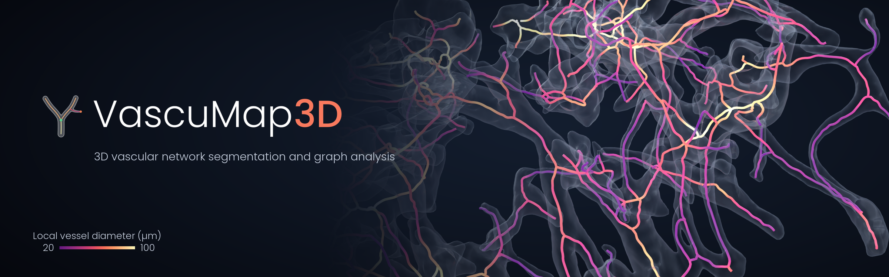
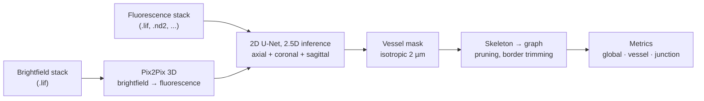

<p align="center">
  
</p>

<p align="center"><sub>Vascular network in the vascular chamber of a microfluidic device, rendered in 3D. Segmented vessel surfaces are drawn as grey glass; centrelines are coloured by the local inscribed vessel diameter (20–100 µm).</sub></p>

<p align="center">
  <a href="https://www.python.org/downloads/"></a>
  <a href="https://lightning.ai/"></a>
  <a href="https://cupy.dev/"></a>
  <a href="LICENSE"></a>
</p>

# VascuMap3D

VascuMap3D is a Python pipeline that segments three-dimensional (3D) vascular networks from confocal microscopy stacks and converts them into graphs from which morphometric and topological metrics are computed. The pipeline accepts either brightfield stacks, which a 3D image-to-image translation network converts into fluorescence-like volumes, or fluorescence stacks of the vessels directly. Segmentation is performed with a 2D U-Net applied along the three orthogonal axes (2.5D inference), and the resulting mask is skeletonised, converted into a graph and pruned on the GPU before vessel-level, junction-level and sample-level metrics are reported in physical units.

## Pipeline



1. **Loading and resampling.** Each 3D stack is read from a Leica `.lif` file (or any format supported by `aicsimageio`, such as Nikon `.nd2`) and resampled to a reference voxel size of 5 × 2 × 2 µm (Z, Y, X). An optional auto-focus and template-registration step crops every stack to a slab that follows the curved focal surface of the device.
2. **Image translation.** For brightfield input, a 3D Pix2Pix generative adversarial network, with a MONAI 3D U-Net generator and a 3D convolutional discriminator, predicts a fluorescence-like volume. Fluorescence input bypasses this step.
3. **Segmentation.** A 2D U-Net with a MiT-B5 encoder (`segmentation_models_pytorch`) is applied to 256 × 256 tiles with Gaussian-weighted sliding windows. In 2.5D mode the volume is first made isotropic at 2 µm, the probabilities predicted along the axial, coronal and sagittal planes are averaged, and the mean probability is median-filtered (size 7) and binarised by hysteresis thresholding (0.2, 0.5).
4. **Graph construction.** The hole-filled mask is skeletonised by 3D thinning in overlapping GPU chunks, converted into a graph with `sknw`, and pruned. Terminal branches are kept as sprouts only when they taper (tip-to-origin cross-sectional area ratio ≤ 0.20) and exceed 50 µm; shorter spurs (< 80 µm), short self-loops (< 40 µm) and small isolated components (< 20 µm) are removed, edges that reach within 100 µm of the lateral borders or 2 µm of the top and bottom of the volume are discarded, and degree-2 nodes are merged so that every edge runs from one junction or end point to the next.
5. **Metrics.** Lengths, cross-sectional areas and volumes are reported in µm, µm² and µm³. Cross-sectional areas are estimated in two ways: a fast elliptical approximation from the 3D and projected distance transforms, and an exact estimate in which every foreground voxel is assigned to its nearest centreline voxel (a Voronoi partition computed with a GPU feature transform).

All length thresholds are expressed in micrometres and converted with the voxel size, so the same parameters apply to masks at other resolutions (`--voxel_size_um`).

## Installation

VascuMap3D requires Python 3.9 or later and a CUDA-capable GPU, because the graph stage relies on CuPy.

```bash
git clone https://github.com/LRpz/VascuMap3D.git
cd VascuMap3D

conda create -n vascumap python=3.9
conda activate vascumap
pip install -r requirements.txt
```

`requirements.txt` installs `cupy-cuda12x`; replace it with the wheel that matches the local CUDA toolkit (`cupy-cuda11x` or `cupy-cuda13x`). The pipeline was tested with Python 3.9, PyTorch 2.8 (CUDA 12.8), albumentations 2.0 and torchmetrics 1.8.

## Usage

### Segmentation

Brightfield `.lif` stacks are translated with Pix2Pix 3D before segmentation:

```bash
python -m vascumap.pipeline.main \
    --input_dir /path/to/lif/files \
    --model_p2p_path /path/to/translation.ckpt \
    --model_smp_path /path/to/segmentation.pth \
    --crop_profile dorota --crop_profile_dir /path/to/crop_profiles
```

Fluorescence stacks are segmented directly, here the green fluorescent protein (GFP) channel of Nikon `.nd2` files without cropping:

```bash
python -m vascumap.pipeline.main \
    --input_dir /path/to/nd2/files --pattern "*.nd2" \
    --fluo_channel GFP --no_crop \
    --model_smp_path /path/to/segmentation.pth
```

Each stack yields `<file>_<stack>_vessel_mask.tif` (isotropic 2 µm) and `<file>_<stack>_overview.png` next to the input file; `--save_all_stacks` also saves the resampled input, the translated volume and the probability map. Further options are listed by `python -m vascumap.pipeline.main --help`. Crop profiles are created with [`notebooks/new_crop_profile.ipynb`](notebooks/new_crop_profile.ipynb).

### Graph analysis

```bash
python -m vascumap.pipeline.graph_main \
    --masks_dir_path /path/to/masks \
    --file_suffix _vessel_mask \
    --voxel_size_um 2.0 \
    --save_local_metrics \
    --graph_visualization
```

### Python interface

```python
from vascumap.pipeline import run, process_directory

run(input_dir="/path/to/data", model_p2p_path="translation.ckpt",
    model_smp_path="segmentation.pth", crop=False)

process_directory("/path/to/data", suffix="_vessel_mask",
                  save_local_metrics=True, voxel_size_um=2.0)
```

[`notebooks/pipeline.ipynb`](notebooks/pipeline.ipynb) runs both stages and documents every parameter.

### Trained models

Trained checkpoints are not distributed with this repository. Both networks can be trained with the provided scripts:

```bash
# Pix2Pix 3D: paired brightfield (input) and fluorescence (target) volumes
python -m vascumap.models.image_translation.train \
    --input_path /path/to/brightfield --target_path /path/to/fluorescence \
    --model_path /path/to/checkpoints --batch_size 4 --epochs 200

# 2D U-Net: image tiles and binary masks
python -m vascumap.models.segmentation.training \
    --images_dir_path /path/to/images --masks_dir_path /path/to/masks \
    --model_dir_path /path/to/checkpoints \
    --model_architecture Unet --encoder_architecture mit_b5 \
    --batch_size 16 --epochs 200 --learning_rate 1e-3 --fp16
```

## Outputs

`graph_main` writes one row per mask to `global_metrics_<method>.csv` and, with `--save_local_metrics`, one vessel table and one junction table per mask (`<sample>_vessel_metrics_<method>.h5`, `<sample>_junction_metrics_<method>.h5`).

| Level | Metrics |
|---|---|
| Sample | `chip_volume` (convex hull of the border-trimmed mask, µm³), `vessel_volume`, `vessel_volume_fraction`, `total_vessel_length`, branch, sprout and junction counts, `vessel_length_density`, sprout and junction densities per vessel length and per chip volume, skeleton fractal dimension and lacunarity, and the median and standard deviation (heterogeneity) of tortuosity, cross-sectional area (fast and exact) and the nearest-neighbour spacing of junctions and sprout tips |
| Vessel (edge) | length, end-to-end distance, tortuosity, volume, mean, median and standard deviation of the cross-sectional area (fast and exact), sprout flag, degrees of both end nodes, orientation unit vector, centreline voxel coordinates |
| Junction (node) | position, degree, junction or sprout-tip label, distance to the nearest junction and to the nearest sprout tip, number of junctions and sprout tips within 500 µm |

Junctions are nodes of degree three or more. A vessel is classified as a sprout when one of its end points was a free end in the unpruned skeleton.

## Repository structure

```
VascuMap3D/
├── vascumap/
│   ├── models/
│   │   ├── image_translation/   # Pix2Pix 3D: generator, discriminator, dataset, training CLI
│   │   └── segmentation/        # 2D U-Net: Lightning module, dataset, transforms, training CLI
│   └── pipeline/
│       ├── main.py              # inference: loading, cropping, translation, 2.5D segmentation
│       ├── graph_main.py        # graph construction and metrics, CLI
│       ├── data.py              # .lif and aicsimageio readers, resampling
│       ├── preprocessing.py     # auto-focus, template registration, cropping
│       ├── prediction.py        # model loading and sliding-window inference
│       ├── skeletonization.py   # chunked 3D thinning, pruning, border trimming
│       ├── mesh_contraction.py  # alternative skeletonisation by mesh contraction
│       ├── metrics.py           # cross-sectional areas, vessel and junction metrics, fractal analysis
│       ├── visualization.py     # network figure, graph-to-image conversion
│       └── utils.py             # GPU chunk processing, resampling, mask post-processing
├── notebooks/                   # end-to-end pipeline and crop-profile creation
├── docs/assets/                 # banner and logo (SVG and PNG, for dark and light backgrounds)
├── DOCUMENTATION.md             # detailed technical documentation
└── requirements.txt
```

[`DOCUMENTATION.md`](DOCUMENTATION.md) describes every stage, its parameters and its outputs in detail.

## Citation

If VascuMap3D contributes to published work, please cite the repository (see [`CITATION.cff`](CITATION.cff)):

```bibtex
@software{vascumap3d,
  author  = {Rappez, Luca},
  title   = {{VascuMap3D}: 3D vascular network segmentation and graph analysis},
  year    = {2026},
  version = {1.1.0},
  url     = {https://github.com/LRpz/VascuMap3D}
}
```

## License

VascuMap3D is released under the MIT License (see [`LICENSE`](LICENSE)).
